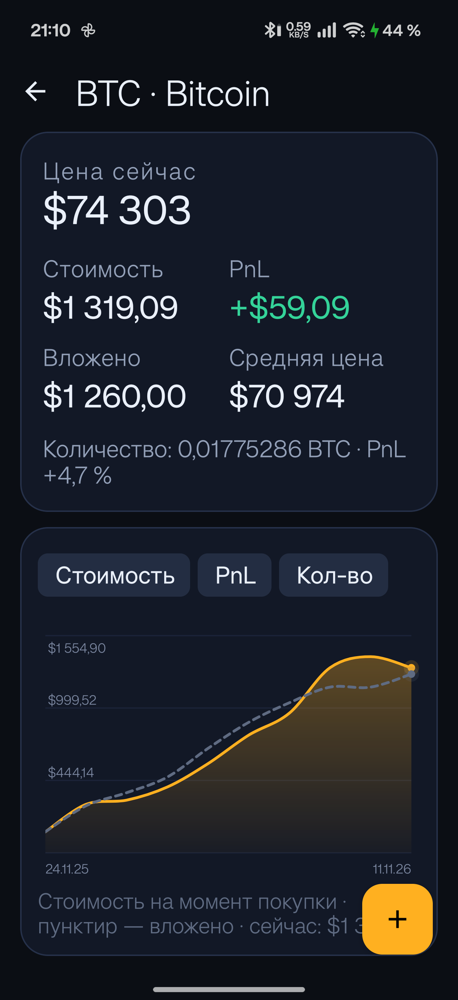
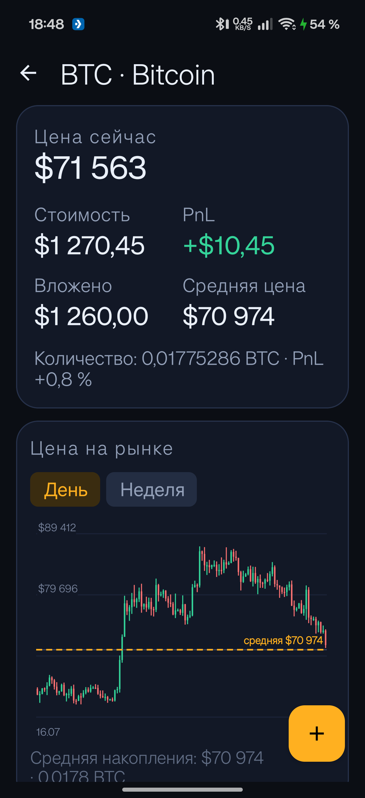
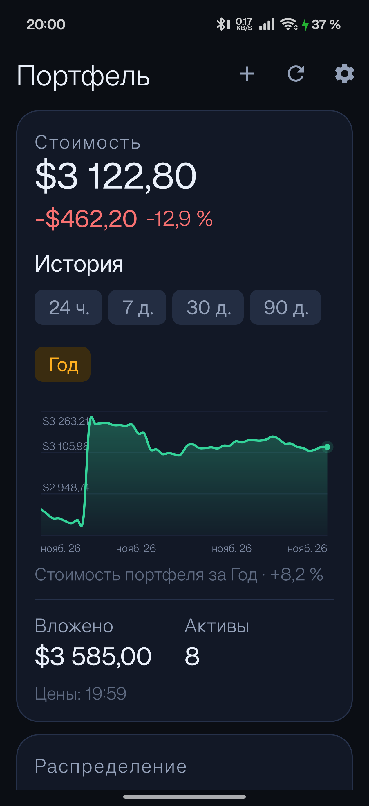
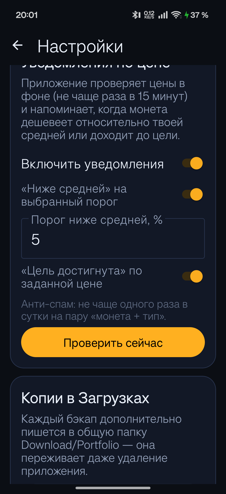
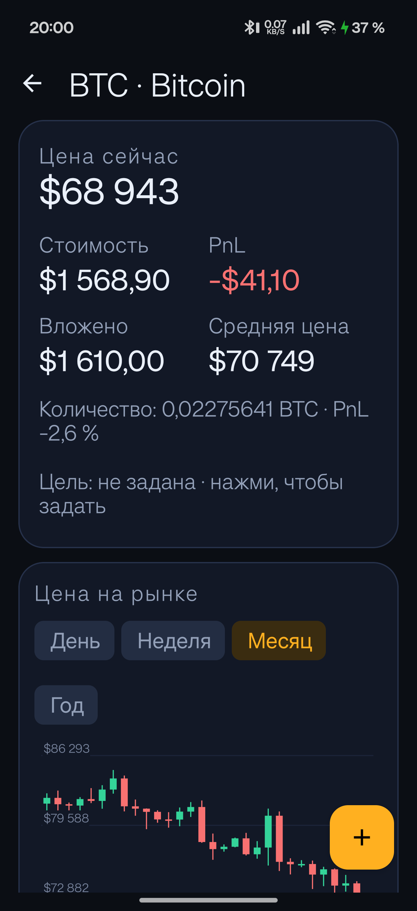
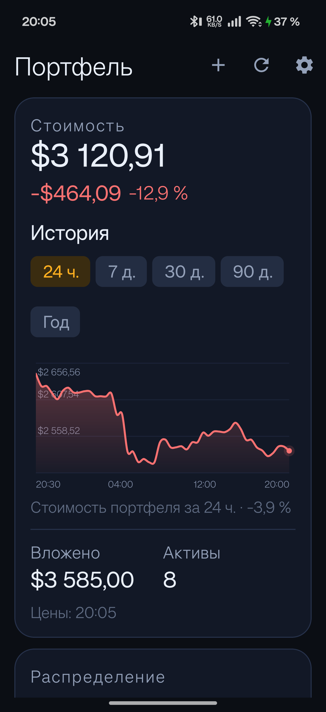
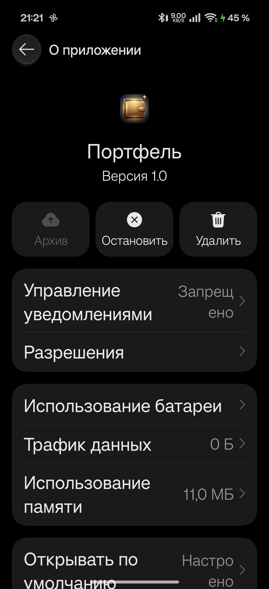

# Портфель (PortfolioAndroid)

Android-приложение для учёта криптопортфеля: живые цены, история стоимости, свечные графики,
уведомления по цене и **резервные копии, чтобы данные не потерялись при сносе приложения**.

`applicationId: com.brotik.portfolio` · версия **1.7** · minSdk 29 (Android 10) · targetSdk 35 · Kotlin + ViewBinding (без Compose)

## Скриншоты

| Портфель | Монета | Свечи |
|---|---|---|
|  |  |  |

| История за год | Уведомления по цене | Настройки |
|---|---|---|
|  |  |  |

| Восстановление из копии | Иконка |
|---|---|
|  |  |

## Что умеет

**Экран «Портфель»**
- стоимость, PnL в деньгах и процентах, вложено, число активов, донат распределения;
- график истории с чипами **24 ч. / 7 д. / 30 д. / 90 д. / Год** прямо в карточке стоимости;
- список монет со спарклайнами; «+» — добавить монету, долгое нажатие — удалить;
- виджет на рабочий стол: стоимость, PnL %, время цен, кнопка обновления.

**Экран монеты**
- цена, метрики, свечной график (День/Неделя/Месяц/Год) с горизонтальной линией средней цены накопления;
- график портфеля по монете с чипами «Стоимость / PnL / Кол-во», строка «Цель», список докупок;
- диалог записи: дата, переключатель **Покупка / Продажа**, сумма, цена; продажа хранится
  отрицательной суммой (как в исходной таблице) и уменьшает накопленное количество.

**Цены** — Bybit spot (`lastPrice`), запасной источник CoinGecko; автообновление воркером.

**Резервные копии**
- один файл `portfolio-latest.json` перезаписывается: выбранная SAF-папка **и** `Download/Portfolio`
  через MediaStore (работает и без выбранной папки), плюс приватная копия в `filesDir`;
- ручная копия кнопкой «Сделать копию сейчас» (авто-копия по умолчанию выключена);
- автовосстановление при старте: берётся самый свежий кандидат (SAF / Загрузки / приватная),
  пустые данные → seed из `assets/seed.json` и предложение копии;
- все SAF/MediaStore-операции вынесены в `Dispatchers.IO` (лечение ANR), SAF-latest пишется
  через `.tmp` + rename, чтобы не потерять единственную копию.

**Уведомления по цене** (WorkManager, один periodic-воркер на 15 мин: цены + уведомления + виджет)
- «ниже средней» на порог (по умолчанию 5 %, допустимо 0,5…90 %);
- «цель достигнута» по `targetPrice` монеты;
- анти-спам 24 ч на пару «монета + тип», канал `price_alerts`, разрешение
  POST_NOTIFICATIONS спрашивается один раз и не поверх диалога восстановления.

## Формулы (1-в-1 с исходной Google-таблицей)

```
куплено      = инвестировано / цена
накопительно = Σ куплено
стоимость    = накопительно × цена
PnL          = стоимость − Σ инвестиций
средняя      = Σ инвестиций / накопительно
```

Проверено юнит-тестами на эталонах из таблицы (BTC: invested 1260 → amount 0.01775285563,
PnL 48.38546 при 73700, средняя 70974.49707).

## Структура

```
app/src/main/java/com/brotik/portfolio/
  core/    Calc, HistoryCalc, Alerts (чистая логика), Candle, Models, Fmt
  data/    Store, PriceRepository, BackupManager, DownloadBackups, RestorePick, AlertPrefs, Http
  ui/      MainActivity, CoinActivity, SettingsActivity, адаптеры, кастомные вью (свечи, линия, донат, спарклайн)
  notify/  AlertNotifier
  work/    RefreshWorker (цены + уведомления + виджет)
  widget/  PortfolioWidgetProvider
app/src/main/assets/seed.json   — разовые данные, зашитые из таблицы
app/src/test/java/...           — 59 юнит-тестов (JUnit + Robolectric)
tools/build.ps1                 — сборка в песочнице
```

## Сборка

Нужны JDK 17 и Android SDK (platform 35, build-tools). В песочнице DSH пути берутся из
`tools/build.ps1` (`JAVA_HOME`, `ANDROID_HOME`, `GRADLE_USER_HOME`), gradle — 8.13.

```powershell
# юнит-тесты
powershell -ExecutionPolicy Bypass -File tools/build.ps1 test

# APK (prod-вариант, подписанный, если рядом лежит keystore.jks)
powershell -ExecutionPolicy Bypass -File tools/build.ps1 apk

# debug-сборка
powershell -ExecutionPolicy Bypass -File tools/build.ps1 debug
```

Скрипт — обёртка над `gradle: :app:testDebugUnitTest | :app:assembleProd | :app:assembleDebug`.

**Про подпись:** `keystore.jks` и `keystore.properties` в репозитории отсутствуют (в `.gitignore`).
Без них проект собирается и тесты проходят, но релизный APK будет неподписанным — положи ключи
в корень проекта локально.

## Приватность

Репозиторий приватный: внутри личные данные учёта (seed-снимок покупок) и никаких секретов —
токены, ключи подписи и `local.properties` исключены. Сетевые запросы идут только к Bybit и
CoinGecko, телеметрии нет.

## Релизы

Готовые APK — на странице [Releases](../../releases). Текущий: **v1.7**.
